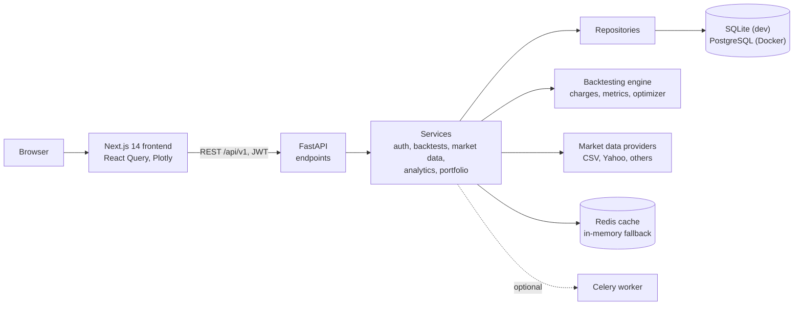

# QuantForge

**A research and backtesting platform for Indian equity strategies.**
Build a rule-based strategy, test it on NSE/BSE price history with Indian transaction charges
taken out of every simulated trade, and read risk-adjusted results before risking any money.

> QuantForge is a research tool. It is not connected to any broker, never places orders, and
> does not provide investment advice.

---

## 1. Overview and purpose

QuantForge is a full-stack web application: a Python/FastAPI backend that runs backtests and
computes metrics, and a Next.js frontend for building strategies and reading results. It was
built as a portfolio project to show end-to-end engineering on a domain with real correctness
requirements: financial calculations, data integrity, authentication and a usable interface.

## 2. The problem it solves

Retail backtesting tools often report returns *before* costs. In Indian markets, statutory
charges are significant and asymmetric: on a ₹1,00,000 delivery round trip, securities
transaction tax alone is ₹200. A strategy that trades often can look profitable gross and lose
money net.

QuantForge models those costs on every simulated fill, and then asks whether a result is
robust: does it survive higher costs, does it hold across different periods, and how wide is the
uncertainty around the headline number?

## 3. Intended users and core workflows

**Users:** individual quants, students and small research teams who think in rules, plus
evaluators exploring the seeded demo account.

**Core workflow:**

1. **Load data:** upload a CSV of daily bars, or download from Yahoo Finance.
2. **Build a strategy:** pick one of 21 built-in strategies and set its parameters.
3. **Run a backtest:** choose symbols, dates, capital, position size, stops, slippage and the
   charge model.
4. **Read results:** returns, risk metrics with confidence intervals, an equity and drawdown
   chart, price and trade markers, monthly returns and a trade blotter.
5. **Test robustness:** walk-forward validation across sub-periods and cost-sensitivity tables.
6. **Compare and allocate:** overlay backtests, rank them, view correlations, and run the
   portfolio optimizer.
7. **Organise research:** watchlists, research notes and a manual paper portfolio.

## 4. Architecture and data flow



**A backtest request, step by step:**

1. The frontend posts the backtest configuration with the user's access token.
2. The service checks the user owns (or may use) the strategy, saves a pending backtest, and
   dispatches it to Celery. If no broker is reachable it runs synchronously instead.
3. The engine loads stored bars, computes the strategy's signals, lags them one bar, simulates
   trades with slippage and charges, and builds an equity curve.
4. Metrics, trades and the equity curve are stored. The frontend polls the status endpoint and
   then loads the results.

The backend is layered: endpoints → services → repositories → models, with indicators,
strategies and data providers each behind a registry.

## 5. Technology stack

| Technology | Role |
|---|---|
| **FastAPI**, Pydantic v2 | REST API, request and response validation |
| **SQLAlchemy 2.0**, Alembic | ORM and schema migrations (SQLite and PostgreSQL) |
| **pandas**, **NumPy** | Indicators, signal generation, vectorised calculations |
| **SciPy** | Constrained optimisation for the portfolio optimizer |
| **Celery**, **Redis** | Optional async backtests and caching, with in-process fallbacks |
| **python-jose**, **passlib/bcrypt** | JWT tokens and password hashing |
| **slowapi** | Rate limiting on auth, upload and write endpoints |
| **Next.js 14**, TypeScript | App Router frontend |
| **TanStack Query**, Zustand, Axios | Server state, auth state, HTTP with token refresh |
| **Tailwind CSS**, Radix UI | Styling and accessible primitives |
| **Plotly.js** | Financial charts |
| **pytest**, **Vitest**, **Playwright** | Backend tests, frontend unit tests, browser smoke tests |
| **GitHub Actions**, Docker, Nginx | CI pipeline and container configuration |

## 6. Features

- **Authentication:** registration, login, refresh-token rotation, logout, profile and password
  change, password reset.
- **Market data:** CSV upload and Yahoo Finance download behind a common provider interface,
  with caching and de-duplication. Kite Connect, Upstox, Angel One SmartAPI, NSE official,
  Alpha Vantage and Polygon providers are implemented but unverified (see section 12).
- **17 technical indicators**, among them SMA, EMA, MACD, ADX, RSI, Stochastic, Bollinger Bands,
  ATR, VWAP, SuperTrend, Williams %R, CCI, Aroon, Parabolic SAR, OBV and MFI.
- **21 strategies**, for example moving-average and EMA crossovers, MACD, RSI and Bollinger
  mean reversion, Donchian breakout, SuperTrend, time-series momentum and buy-and-hold.
- **Backtest engine:** single and multi-asset backtests, periodic rebalancing, long and short
  positions, position sizing, stop-loss and take-profit.
- **Indian charge model:** flat commission, or Indian equity delivery and intraday charges.
- **Risk metrics and robustness:** a full metric set with bootstrap confidence intervals,
  walk-forward validation, and cost sensitivity.
- **Analytics:** multi-backtest comparison, correlation matrix, risk/return scatter, and a
  portfolio optimizer with five methods: equal weight, mean-variance, risk parity, maximum
  Sharpe and minimum volatility.
- **Dashboard:** market overview, breadth, top movers and a sector heatmap, each dated to the
  latest stored price.
- **Workspace:** paper portfolio, watchlists, research notes, command palette, light and dark
  themes.

## 7. Backtesting, data and cost model

### Execution model

- A strategy produces a signal per bar: long, short or flat.
- Signals are **lagged one bar** and executed at the next bar's close, so a decision never uses
  information from the bar it trades on.
- Stops and targets are checked against each bar's high and low. If a bar **gaps through** a
  level, the fill is at the open, not the untouched trigger price. If both are hit in one bar,
  the stop takes precedence.
- Slippage is applied against the trader on entry and exit.

### Indian transaction charges

The charge model in `backend/app/backtesting/charges.py` applies the following statutory rates:

| Charge | Delivery | Intraday |
|---|---|---|
| Securities transaction tax | 0.1% on buy and sell | 0.025% on sell only |
| Exchange transaction charges | 0.00297% each leg | same |
| SEBI turnover fee | ₹10 per crore each leg | same |
| Stamp duty | 0.015% on buy only | 0.003% on buy only |
| GST | 18% of brokerage + exchange charges | same |

Buy and sell legs are charged separately. A short position opens with a sale and closes with a
purchase, and is charged accordingly. Rates reflect commonly published values at build time and
should be checked against current NSE/SEBI circulars.

### Risk metrics

Total return, CAGR, annualised volatility, maximum drawdown, Sharpe, Sortino (using downside
deviation), Calmar, Omega, Ulcer index, 95% VaR and CVaR, win rate, profit factor, expectancy,
maximum losing streak, and Jensen's alpha and beta against a benchmark. Sharpe and Sortino
accept a configurable risk-free rate. Block-bootstrap 95% confidence intervals are reported for
Sharpe and CAGR.

### Robustness tools

- **Walk-forward validation** re-runs the same fixed parameters on consecutive windows of the
  period. It checks consistency across regimes; it does not re-optimise parameters per window.
- **Cost sensitivity** re-runs the same signals with costs scaled from 0× to 2×.

## 8. Data integrity and security

- **Passwords** hashed with bcrypt; JWT access tokens (30 minutes by default) and refresh tokens
  (7 days by default) that are tracked by ID and revocable.
- **Authorization:** every user-owned resource (strategies, backtests, watchlists, notes,
  portfolio) is checked against the requesting user. Roles: user and admin.
- **Shared market data:** normal users can add new bars but never overwrite existing ones; only
  admins can overwrite. CSV uploads are limited to 5 MB.
- **Password reset:** tokens are single-use (they become invalid once the password changes,
  however it changes) and are never written to logs.
- **Rate limiting** on authentication, data download, backtest creation and write endpoints.
- **Configuration:** the app refuses to start in production with the development secret key.
  Secrets come from environment variables and are never committed.
- **Synthetic data labelling:** seeded demo prices are stored with a `synthetic` source and
  labelled wherever they appear.

## 9. Testing strategy and results

| Suite | Scope | Result (2026-10-27) |
|---|---|---|
| Backend `pytest` | 191 tests: indicators, strategies, engine, charges, metrics (including hand-computed checks), optimizer, providers, auth, permissions, market data, API flows, security boundaries, PostgreSQL value adaptation | 191 passed |
| Frontend Vitest | Currency and percent formatting, auth error handling | 6 passed |
| Playwright smoke | Login, dashboard, backtest detail tabs, portfolio, wrong-password handling | 4 passed (run against a local seeded stack) |
| Static checks | ruff, black, ESLint, TypeScript | clean |
| Production build | Next.js | succeeded, 17 routes |
| Backend in Docker | Same 191 tests, ruff and black, inside the backend image (Python 3.12) | 191 passed, clean |
| Docker Compose stack | Clean `up --build` on fresh Postgres and Redis; health checks; register, login, CSV upload and CORS through Nginx; 8 seeded backtests through the Celery worker; Playwright smoke tests | all services healthy, all flows passed, 8 of 8 backtests completed, 4 of 4 Playwright passed |

The financial-correction tests use small hand-built price series with expected values worked out
by hand, for example a stop gapped through at the open, or a short trade's charge legs. They
check exact numbers, not just "the code ran".

CI on GitHub Actions is configured to run linting, backend tests with coverage, frontend type
checking, unit tests and a build, plus Docker image builds. It has not yet run on GitHub, because
the repository has not been pushed.

## 10. UI/UX and accessibility

- **Visual design:** a consistent token-based design with a dark default theme and a light
  alternative. Rupee formatting with lakh and crore grouping, and tabular figures for numbers.
- **Every data view has loading, empty and error states.** A failed request shows the error and
  a retry button rather than an empty list or an endless spinner.
- **Deletes ask for confirmation.**
- **Mobile:** layouts were adapted for 390 px wide phones.
- **Accessibility:** an axe-core audit reported **0 violations across 32 page checks** (16 routes
  at desktop and mobile widths, dark theme). Keyboard checks confirmed a working skip link,
  visible focus on every stop tested, focus-trapped dialogs and arrow-key tabs. Reduced-motion
  preferences are respected.

## 11. Installation and local development

Requirements: Python 3.12+ and Node 20+. Redis is optional.

```bash
# Backend
cd backend
python -m venv .venv
source .venv/Scripts/activate        # Windows Git Bash; .venv/bin/activate on macOS/Linux
pip install -r requirements.txt
cp ../.env.example ../.env           # set SECRET_KEY at minimum
alembic upgrade head
uvicorn app.main:app --reload        # http://localhost:8000/api/v1

# Seed the demo account and synthetic demo data (backend must be running)
python ../scripts/seed_demo_data.py

# Frontend
cd ../frontend
npm install
# set NEXT_PUBLIC_API_URL=http://localhost:8000/api/v1 in .env.local
npm run dev                          # http://localhost:3000
```

Notes:

- If the frontend runs on a port other than 3000, add it to `CORS_ORIGINS`.
- In development, password-reset emails are written to `backend/dev_outbox/` instead of being
  sent.
- Docker Compose (`docker compose up --build`) defines Postgres, Redis, the API, a Celery
  worker, the frontend and Nginx. Copy `.env.example` to `.env` and set a random `SECRET_KEY`
  first: the example sets `ENVIRONMENT=production`, and the API refuses to start with the example
  key. Then open http://localhost.

## 12. Known limitations and honest caveats

- **Demo data is synthetic.** The seeded prices for RELIANCE, TCS, NIFTY 50 and the other demo
  symbols are random walks generated by the seed script. Backtests on them are illustrative only.
- **Live data providers are unverified.** Kite, Upstox, Angel One, NSE official, Alpha Vantage and
  Polygon have not been tested against their real APIs. Yahoo Finance was rate-limited in the
  original build environment.
- **No live trading** and no real-time quotes. The paper portfolio records manual entries only.
- **Execution simplifications:** next-bar close execution, and shorts without borrow fees or
  margin.
- **Opening Range Breakout** needs intraday data; the platform currently works with daily bars.
- **Not verified:** any public deployment.
- **Not production-ready:** rate limits are shared across clients behind Nginx, there is no
  Content-Security-Policy, and Starlette and Next.js 14 have advisories that need upgrades.
- **Charge rates** may need updating to current regulations.

## 13. Recruiter demo script (about 5 minutes)

1. **Home page:** "QuantForge tests trading rules on Indian market history, after the real
   charges." Point at the charges section: ₹222.21 of costs on a ₹1,00,000 round trip.
2. **Log in** with the demo account. On the dashboard, note the "Synthetic demo data" notice:
   the demo data is honestly labelled.
3. **Strategy builder:** show the strategy cards and open "Run backtest" to show the
   configuration, including the Indian charge model.
4. **Backtest detail:** open "CCI Trend - SUNPHARMA". Walk through the metrics, then the
   **Cost Sensitivity** tab: the strategy earns +7.34% before costs and −13.00% after them. That
   is the problem the tool exists to expose.
5. **Walk-forward tab:** results differ sharply between windows; the edge isn't stable.
6. **Analytics:** select two backtests and compare equity curves and correlation.
7. **Engineering:** close with the test suite, the hand-computed financial tests and the
   accessibility audit.

## 14. Engineering decisions and lessons (interview talking points)

- **Avoiding look-ahead bias:** signals are shifted one bar before execution, and fills use only
  information available at that time. A backtest is only as good as its timing assumptions.
- **Gap-aware fills:** an early version filled stops at the trigger price even when a bar opened
  beyond it, which flatters results. The fix fills at the open, with tests built on hand-made
  gap scenarios.
- **Getting formulas exactly right:** Sortino needs downside deviation over all periods; alpha
  should be Jensen's alpha net of the risk-free rate; CAGR counts return periods, not price
  points. Each was corrected with a test whose expected value was calculated by hand.
- **Being honest about a non-bug:** one suspected issue (back-filling multi-asset equity) turned
  out to be harmless. It was kept as a guard and documented rather than claimed as a fix.
- **Data integrity in a multi-user system:** shared reference data needed an add-only rule for
  normal users. Fixing it also exposed a cache bug where reads returned stale prices.
- **Security details:** single-use reset tokens without a database table, by embedding a
  fingerprint of the password hash; no tokens in logs.
- **Failure states:** a failed request must never look like an empty list. A shared error
  component and stopping status polling on failure fixed misleading states found by simulating
  API errors in the browser.
- **Honesty in a portfolio project:** synthetic data is labelled, and unverified integrations
  are stated as unverified.
- **Testing approach:** unit tests with exact expected values for finance, API tests for
  permissions and flows, and browser tests for real user journeys and accessibility.

## 15. Resume description

**QuantForge: Indian equity backtesting platform** (Python, FastAPI, SQLAlchemy, pandas, Next.js,
TypeScript)

- Built a full-stack research platform to backtest 21 rule-based strategies on NSE/BSE data,
  modelling Indian statutory charges (STT, stamp duty, exchange fees, SEBI fee, GST) on every
  simulated trade.
- Implemented a backtest engine with one-bar signal lag, gap-aware stop and target fills, long
  and short positions and rebalancing, plus risk metrics with block-bootstrap confidence
  intervals, walk-forward validation and cost-sensitivity analysis.
- Secured the API with JWT auth, role-based permissions, rate limiting and single-use reset
  tokens, and protected shared market data from overwrites by normal users.
- Covered the system with 191 backend tests (including hand-computed financial checks), frontend
  unit and Playwright smoke tests, and an accessibility audit with zero axe-core violations.
- Made the Docker Compose stack (FastAPI, Celery, PostgreSQL, Redis, Next.js, Nginx) start
  cleanly from scratch, fixing Postgres-only bugs (a missing enum type, NumPy values breaking
  trade inserts) and a worker migration race.
