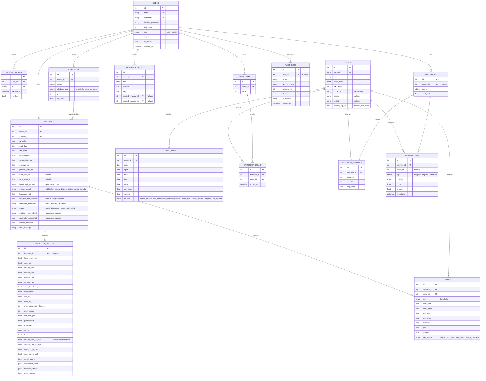

# Database ER Diagram

Generated from the SQLAlchemy models in `backend/app/models/`. The initial Alembic migration
(`backend/alembic/versions/b5ae66c763f8_initial_schema.py`) creates exactly this schema — verified
to apply cleanly to a fresh database with zero drift (`alembic check`).

## Notable design choices

- `market_data` is unique on `(asset_id, date)` — the enforcement mechanism behind "prevent
  duplicate downloads," combined with an app-level check (`MarketDataService._is_range_fully_cached`)
  that skips the external API call entirely when the requested range is already stored.
- `backtests` carries `strategy_version_hash` and `parameters_snapshot` rather than only a foreign
  key to `strategies` — a strategy's parameters can be edited later without invalidating the
  reproducibility of past results (experiment tracking, see `docs/ARCHITECTURE.md`).
- `backtest_results` is 1:1 with `backtests` (not embedded) so the heavy JSON payloads (equity
  curve, drawdown curve, monthly/daily returns) are only ever loaded when actually requested via
  `/backtests/{id}/equity`, not on every list/status call.
- `backtests` has a composite index on `(owner_id, status)` (not just the individual FK index on
  `owner_id`) for the "my running/completed backtests" dashboard query; `strategies.is_public` is
  independently indexed for the public-strategy-catalog filter. Both were added after finding the
  gap via `EXPLAIN`-style reasoning about actual query patterns, not just indexing every column.
- Every list endpoint that serializes a relationship (`WatchlistRead.items[].asset`,
  `AnalyticsService.compare`'s `backtest.strategy`) uses `selectinload`/`joinedload` explicitly —
  verified by a dedicated query-count regression test (`tests/unit/test_query_efficiency.py`)
  rather than assumed correct by inspection.
